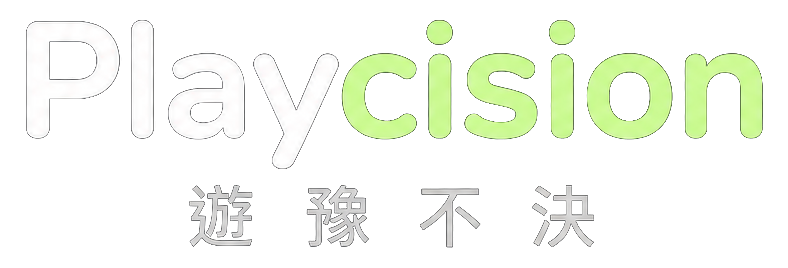
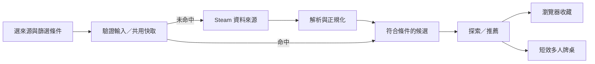

<p></p>

**遊戲買了，朋友上線了，今晚還是選不出來。**

**[直接開玩 → Playcision](https://playcision.bm1016bm-cf7.workers.dev/)**

Playcision 想處理的就是這一小段很熟悉的卡關：從 Steam 找到想玩的遊戲，把心動的留下，再和朋友選出今晚那一款。

我是台灣的開發者 [@bm1016bm-svg](https://github.com/bm1016bm-svg)。我把它做成一個有點像逛唱片行、又有點像朋友開桌討論的遊戲探索工具。你可以慢慢看封面，也可以直接篩選；再選不出來，就讓骰子接班。

> Stop browsing. Start playing.　別選了，開始玩。

[使用與開發說明](README.zh-TW.md) · [資料來源](docs/steam-data.md) · [Cloudflare 部署](docs/cloudflare-release.md) · [回報問題](https://github.com/bm1016bm-svg/playcision/issues)

## 先找到想玩的，再找朋友開一桌

| 想做的事 | Playcision 的做法 |
| --- | --- |
| 隨便逛逛，看看有沒有對到電波 | **探索**：左滑略過、右滑收藏，也能用方向鍵與按鈕。 |
| 不想一直盯著同一張卡 | **推薦**：穿過遊戲封面的開場，接著沿著連接線往下逛。 |
| 今晚的口味很明確 | 依熱門、新品、折扣或 Steam 活動挑來源，再搭配類型、價格、平台與遊玩人數。 |
| 先存著，等我有空再說 | **收藏**：保存在自己的瀏覽器；長按遊戲可整理進自己命名的歷史收藏資料夾，也能分享清單。 |
| 四個人有四種想法 | **今晚一起玩**：開一桌、丟候選、投票。平手就保留平手，沒人投也不硬湊一個冠軍。 |
| 連收藏也選不出來 | 從本次收藏抽一款。骰子不用知道你的人生規劃。 |

多人牌桌從建立起 **10 分鐘到期**，不因操作延長；收藏則留在瀏覽器，不會跟著房間消失。這兩種資料有不同的保存方式，詳細行為見[房間說明](docs/rooms.md)。

類型、價格、平台等一般條件用於探索；AI 聲明排除則會同步套用到探索、推薦與後續載入的遊戲。

## 封面是入口，資料還是得老實做

我沒有把整份 Steam 遊戲庫搬進專案，也沒有在後面藏一個模型替遊戲寫介紹。使用者需要資料時，程式向 Steam 取得候選與商店資訊，經過驗證、正規化和篩選，再交給畫面。



資料分工大致是這樣：

- **遊戲與價格**：Steam Store 搜尋、Store Browse，以及必要時的 `appdetails`，整理 App ID、分類、平台、價格與折扣。
- **封面與介紹**：沿用 Steam 商店素材，依需求載入；取得失敗時保留可繼續操作的畫面。
- **評論**：向 Steam 的評論服務查詢，區分使用者語言與全部語言。沒有資料或查詢失敗，都不補一段看起來很像評論的文字。
- **活動**：從 Steam 的活動索引與活動頁解析名單，再取得活動中的遊戲。這是目前觀察到的商店介面，不能保證列出所有活動或所有參加遊戲。
- **生成式 AI 聲明**：讀取商店頁的揭露區塊。玩家開啟排除後，探索與推薦都會移除已辨識到聲明的遊戲；無法確認的保留。

**AI 排除依據 Steam 聲明，不是「絕對沒用 AI」認證。** 核心查詢、篩選與抽選也不需要 AI 模型。

Steam 的部分商店介面沒有穩定的公開 API 契約，版型、欄位與限流都可能改變。我把這些依賴集中在 provider 層，替解析器保留測試；詳細端點、限制與官方參考放在[資料契約](docs/steam-data.md)，不把「今天抓得到」寫成永久保證。

## 幾個刻意的選擇

**先有節奏，再談動效。** 深色背景、螢光綠與液態玻璃是這個產品的視覺語言。探索負責快速做決定，推薦則留一點慢慢逛的空間。動畫使用目前候選的真實封面；手機保留一般列表，系統選擇減少動態時也能繼續使用。[推薦路徑](docs/recommendation-timeline.md)記錄了實作與取捨。

**收藏放你這裡。** 本次收藏、資料夾與排除偏好存在 `localStorage`，不要求登入，也沒有自動跨裝置同步。清除網站資料會失去這份收藏；「分享」是你主動複製清單，不是替你發文。多人互動才需要伺服器保存短期房間與投票。[隱私與安全](docs/privacy-security.md)

**不要每滑一下就敲一次 Steam。** 相同查詢共用進行中的請求，成功資料使用有期限、有容量的快取；圖片按瀏覽方向預載。查詢有佇列上限、逾時與限流冷卻，核心列表、圖片和 AI 聲明也有各自受限的通道，避免附加資料把主要操作塞住。[減載設計](docs/load-optimization.md)

**免費部署也要有邊界。** 專案提供 Cloudflare Workers 與 SQLite Durable Objects 的部署路線，網站、API 與房間共用同一個來源，不用另外租 VPS。平台免費配額與程式保護上限仍會限制服務；本機測得能跑，不等於已驗證正式環境可承載多少人。[部署與外網驗收](docs/cloudflare-release.md)

## 想自己跑

需要 Node.js **22.12 以上**。從原始碼安裝與建置：

```sh
git clone https://github.com/bm1016bm-svg/playcision.git
cd playcision
npm ci
npm run build
```

以本機 Workers runtime 預覽目前網站：

```sh
npx wrangler dev --config wrangler.jsonc --local --var APP_ORIGIN:http://127.0.0.1:4174
```

開啟 <http://127.0.0.1:4174/>。這個網址只能在自己的電腦使用，預覽入口不需要邀請碼。

專案也保留了 CLI。如果你比較喜歡「跑一次，給我一份清單」：

```sh
node dist/cli.js init
node dist/cli.js doctor
node dist/cli.js digest --dry-run
node dist/cli.js ui --open
```

CLI 的規則是可編輯的 YAML，能輸出終端、Markdown、JSON，或在明確設定後送到 Slack。價格追蹤只稱為**本機觀測新低**；同一 seed 的抽選，也需要相同候選池與設定才會重現。[CLI 參考](docs/cli.md) · [設定範例](examples/config.tw.yaml)

開發與檢查：

```sh
npm run dev:ui
npm run check
npm run cloud:bundle
npm run cloud:smoke
```

`dev:ui` 使用 CLI 的本機設定，請先完成 `init`。一般測試採用可控制的時鐘、HTTP transport 與最小測試資料；不把 Steam 當下是否連得上，當成單元測試通過的前提。

## 現在走到哪了

已於 **2026-10-29 公開部署**到 Cloudflare 免費方案。正式 HTTPS、同來源 API、Steam 資料及兩人 WSS 投票流程已驗證；實體手機和不同網路裝置的體驗仍需持續驗收。這些檢查不代表已量測公開服務的承載人數。

自願支持作者的介面已做好，網站尚未完成 PAYUNi 收款串接。作者已回報新增商店，實際核准、信用卡開通與正式付款結果仍未核對。收款進度與獨立遊戲免費曝光的[待實作試辦方案](docs/support-and-indie-pilot.md)另有說明。

如果你願意試玩、回報一個讓你卡住的地方，或替專案點顆星，我都很歡迎。尤其是那種「我以為按下去會這樣，結果它做了另一件事」的回報，對這個產品很有用。

## 給想看實作的人

| 想看什麼 | 從哪裡開始 |
| --- | --- |
| 資料怎麼抓、欄位怎麼驗證 | [`src/provider`](src/provider) |
| 探索、收藏、分享與介面狀態 | [`src/web/consumer`](src/web/consumer) |
| 穿梭開場、推薦路徑、共用 UI | [`src/web/components/ui`](src/web/components/ui) |
| 同來源 API、共用配額與短效房間 | [`cloud`](cloud) |
| CLI、規則與輸出 | [`src/cli.ts`](src/cli.ts)、[`src/application`](src/application) |
| 邊界、失敗情境與回歸測試 | [`tests`](tests) |

React、TypeScript、Vite、Motion 與 GSAP 負責網站；CLI 與 Steam provider 共用 TypeScript 核心。雲端適配器使用 Cloudflare Workers／Durable Objects。沒有加入第三方帳號同步或全站行為追蹤。

## 參考與授權

- [Steam Web API 說明](https://partner.steamgames.com/doc/webapi_overview?language=english)、[評論服務](https://partner.steamgames.com/doc/webapi/IUserReviewsService)、[內容調查與 AI 揭露](https://partner.steamgames.com/doc/gettingstarted/contentsurvey)
- [Steam Web API 使用條款](https://steamcommunity.com/dev/apiterms)
- [Cloudflare 靜態資產計費](https://developers.cloudflare.com/workers/static-assets/billing-and-limitations/)、[Durable Objects](https://developers.cloudflare.com/durable-objects/)
- 程式碼採 [MIT License](LICENSE)。Steam 商標與遊戲素材的權利屬於各自權利人。
